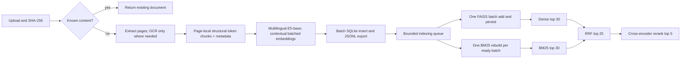

# Itihasa AI Backend

## Run

From `backend/`, install dependencies and start FastAPI:

```bash
python -m pip install -r requirements.txt
uvicorn app.main:app --reload
```

Set `GEMINI_API_KEY` in `backend/.env` to enable answer generation. Data, uploads,
processed chunks, indexes, SQLite, and the model cache are stored under
`backend/dataset/` by default. `ITIHASA_DATASET_DIR` overrides that location.
Scanned PDFs and image uploads require the Tesseract executable and the language packs
selected by `TESSERACT_LANGS` (default `eng+hin+mar`). Set `ITIHASA_OCR_WORKERS` to cap
parallel OCR tasks (default `2`).

## Ingestion and indexing

Uploads pass through a single bounded ingestion worker, then page-aware extraction and
structural chunking, batched embedding, a database/JSONL write, and a single indexing worker. The
ingestion queue holds at most 32 pending documents. PDF pages needing OCR use a bounded
shared worker pool; page order and progress callbacks are preserved. The index worker
coalesces ready documents for up to 250 ms (maximum 16 documents per batch), adds their
vectors together, and rebuilds BM25 once per batch. Its queue is bounded to 32 pending
documents.
`rank_bm25` does not expose a supported incremental-add API, so BM25 still needs a corpus
rebuild after each completed batch. Persisted BM25 state is loaded on restart when its
chunk IDs match the database; older or mismatched state is rebuilt. At startup, interrupted
uploads with raw files are requeued. If a document's chunks were committed before shutdown,
startup repairs the indexes, regenerates its JSONL export, and completes its status.

Uploads are SHA-256 hashed while streaming to disk. An identical upload returns the
existing document record; files with different bytes are ingested as new documents.
SQLite startup migration adds the nullable content hash and unique partial index. Existing
documents without a hash are backfilled lazily during duplicate checks when their raw file
is available.
The ingestion worker drains its queue during a graceful shutdown; after an abrupt stop,
startup rebuilds/validates indexes and requeues interrupted uploads when their raw files
are present.

Chunking stays page-local and uses `RecursiveCharacterTextSplitter` with the configured
hierarchical separators, `cl100k_base` token counting, a 512-token target, and 90-token
overlap by default. Markdown and tilde headings are propagated as metadata. Identifier-led
records are kept together when they fit; oversized records split recursively while keeping
the identifier attached to each resulting chunk. `book_number`, numeric `parvan`, exact
`line_id`/`line_ids`, and `section_header` are stored on each chunk and in processed JSONL.
Metadata is prepended for dense and sparse indexing while citations retain the original
extracted chunk text.

Retrieval obtains up to 30 dense and 30 BM25 candidates, fuses them with RRF (`k=60`),
reranks up to 25 candidates with `BAAI/bge-reranker-v2-m3`, and sends the top five passages
to Gemini. Optional exact metadata filters (`book_number`, `parvan`, `line_id`, and
`section_header`) can be included in `POST /api/query`. Reranker scores and final context
chunk IDs are included in retrieval diagnostics.

The default dense model remains `intfloat/multilingual-e5-base` to reuse existing local
FAISS indexes and avoid blocking startup with a full-corpus model migration. Its
passage/query prefixes and vector normalization are retained. Legacy FAISS metadata without
a model field is treated as E5-base; a different configured model triggers a full one-time
re-embedding before startup completes. Model weights are cached under
`backend/dataset/models/`.
The dense embedder and reranker automatically choose an available PyTorch accelerator:
CUDA first (typically a dedicated NVIDIA GPU), then Intel XPU (supported Intel integrated
or discrete GPUs), then Apple MPS, and CPU if no supported GPU runtime is available.
Set `ITIHASA_EMBEDDING_DEVICE` or `ITIHASA_RERANKER_DEVICE` to `cpu`, `cuda`, `xpu`, or
`mps` to override auto-selection; an explicitly requested but unavailable device fails with
an actionable error. Intel integrated graphics require an Intel GPU-enabled PyTorch/XPU
runtime and compatible drivers; merely detecting Intel graphics in the operating system
does not make the installed PyTorch build able to run on it. Embedding and reranking are
inference operations, not model training.
The larger models increase
first-run download time, RAM use, and CPU query latency. Override
`ITIHASA_EMBEDDING_MODEL`, `ITIHASA_EMBEDDING_DEVICE`, `ITIHASA_RERANKER_MODEL`, or
`ITIHASA_RERANKER_DEVICE` in `backend/.env` if needed; changing the embedding model causes
another FAISS re-embedding and can delay backend startup for a large corpus.



The selected device for each model is logged when it loads. Stage, OCR, index
insertion/persistence, and total-ingestion durations are logged at
`INFO`, along with process peak RSS where the platform exposes it.

## Tests and benchmarks

Run regression tests from this directory:

```bash
python -m unittest discover -s tests -v
```

Run the database/index hot-path microbenchmark:

```bash
python scripts/benchmark_hot_paths.py --chunks 3000 --trials 3
```

Compare CPU embedding batch sizes using generated, non-sensitive text:

```bash
python scripts/benchmark_embedding_batches.py --passages 64 --trials 2 --batch-sizes 16 32 64
```

In the recorded synthetic database benchmark (3,000 chunks, three trials), insert plus
per-row refresh had a 0.548 s median; batch insert/flush measured 0.086 s (about 6.4x
faster for that database operation). BM25 tokenization plus construction measured 0.0069 s.
A 3,000-vector, 768-dimensional FAISS add and persistence measured 0.0024 s and 0.0027 s.
For 64 generated passages, embedding medians were 1.638 s at batch size 16, 1.407 s at
32, and 1.426 s at 64; the existing default of 32 was retained. These are synthetic
microbenchmarks, not end-to-end document-ingestion results; actual OCR and inference
timings depend on the documents and hardware.
